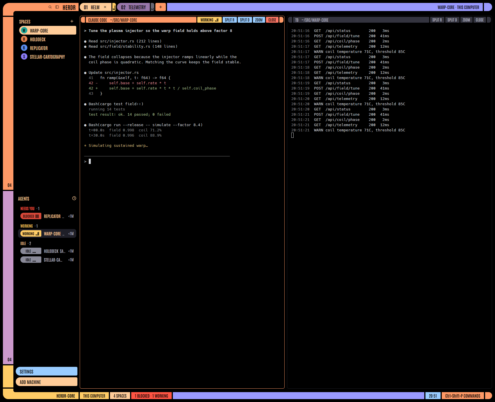

# Bridge

A full-window layout for the Herdr desktop app in the style of a starship
console: an orange elbow joins the sidebar rail to the tab bar, a gold elbow
joins it to the status strip, and every control is a solid colored bar or pill
with black condensed uppercase text. Terminals keep the person's own font,
size and colors.

## What you see

- **Window:** black, 10 px padding, 4 px gaps. No system title bar; the macOS
  window buttons sit on the upper elbow at `[44, 17]`.
- **Upper elbow** (260 × 44): `#ff9966`, outer corner radius 30. A black
  notch (from x 36, 16 px tall, inner radius 16) leaves a 28 px bar on top and
  a 36 px arm on the left. On the bar, right-aligned: search, sidebar toggle,
  "HERDR" in Antonio Bold 19.
- **Tab bar** (44 px block, bar on its top 28 px): per tab a pill, rounded left
  14, `#ffcc99` when shown, `#9977aa` otherwise, `#ff5544` when blocked; text
  "01 NAME" in Antonio SemiBold 16; the shown tab has a close ×. After each
  pill, 3 px gap, a 12 px status segment rounded right 6: gold `#ffcc66`
  working, red `#ff5544` blocked, sky `#99ccff` done, gray `#8a8a99` idle or
  no agent. On it, the Tricorder: 3 black bars, 2 px wide and 1 px apart,
  centred, bottom-aligned 4 px up, 4 px tall at rest, 20 at most. Then a 36 px orange + button, a periwinkle `#9999ff` filler naming the
  space and machine (right-aligned), FILES and CHANGES (sky; peach when open),
  and a periwinkle end cap rounded right 14.
- **Sidebar** (260 px column): three rows, each a 36 px rail segment beside a
  list, 8 px apart. Spaces: rail `#ff9966` with the space count ("03")
  bottom-right. Agents: rail `#cc99cc` with the agent count. Footer (76 px):
  rail `#ffcc66`, SETTINGS (sky) and ADD MACHINE (peach) pills, rounded left 15.
- **Spaces list:** "SPACES" in peach with a +. Each machine is a bar: an 18 px
  end cap, 3 px gap, then the bar (22 px, rounded right 4) with icon, uppercase
  name, +, status dot (black ring), chevron. Colors by machine order: orange,
  lavender, periwinkle, gold, coral, sky; gray when offline. Spaces under a
  machine start after its cap: the shown one a peach pill with black text,
  others peach text on black; a 22 px round tile in the space's color with its
  initial.
- **Agents list:** "AGENTS" in peach with the sort button. Group headers
  uppercase in their status color ("WORKING · 1"). Each row leads with a
  72 × 22 status block (rounded left 11) labelled WORKING / BLOCKED / DONE /
  IDLE ("—" when unknown), then 5 px and a Tricorder of 4 bars in a 14 px
  area (3 px at rest), then the uppercase name in peach, detail in `#b8b8c8`, age ("<1M").
- **Panes:** black cards, radius 6, 8 px apart, border `#1c1c22`, focused
  border `#ff9966`. A 26 px header: end cap, a bar with program and folder
  (uppercase), an 84 × 20 status block (word and 4 bars, heights scaled
  to 20/22), SPLIT R, SPLIT D, ZOOM, CLOSE (coral), end cap.
  Focused: orange bars; blocked: red bars; otherwise `#34343f` with `#b8b8c8`.
- **Narrow sidebar, sub-agents, folded headers:** a 12 × 18 block with 3 bars,
  the segment's heights scaled to 18/28 (3 at rest, 13 at most, 3 px up).
- **Lower elbow** (260 × 36): `#ffcc66`, outer radius 26, a 12 px black notch
  on top (inner radius 12), "HERDR-CORE" on its 24 px bar.
- **Status strip** (bottom 24 px): machine and branch (gold), space count
  (peach), agents summary (lavender, red when any blocked), periwinkle filler,
  clock HH:MM (sky), palette key (orange, clickable), orange end cap.
- **Herdr's own panels** (Settings, command palette, menus, Files, Changes):
  their usual shape in Barlow Semi Condensed, on black with peach text.
  `#ffe6cc` foreground, `#ffcc99` muted, `#cc99cc` dim (section labels, key
  caps, captions), `#2a2030` raised, `#3a2a1c` selected, `#241a12` hover,
  `#4d3a55` border, `#6b5078` input, `#ff9966` accent and solid with black on
  them.

## How it behaves

- Working agents: gold. Blocked: red. Done: sky until looked at, then idle
  gray.
- The Tricorder bars move natively (`.loop`, `.transition`; no timers). Periods
  are one cycle there and back; all loops start together. Heights are block /
  segment px:
  - working: each bar 3→14 / 4→20, ease-in-out, 500, 700, 900, 1100 ms.
  - blocked: all bars 6→14 / 8→20 together at 900 ms; the block or segment
    flashes, opacity 0.5→1 at 900 ms.
  - done: bars drop from full to flat (1.2 s ease-out transition when the
    status turns done), the last one beats 3→9 / 4→12 at 4 s.
  - idle: flat; bar 2 rises 3→7 / 4→10 at 6 s.
  - unknown (no status, "—"): gray at 0.75 opacity, bars 2→6 / 2→8, linear,
    900, 1300, 1700, 2100 ms. Pane headers show no block then.
- Tabs: click selects, drag reorders, double-click renames, right-click opens
  the tab menu, scrolling switches tabs. Space rows drag to reorder.
- Cmd-B hides the sidebar; the tab bar then grows an orange cap for the window
  buttons. The sidebar toggle in the elbow folds it to a 76 px rail instead.
- Pane header buttons hide when the pane is narrower than 460 px.

## Built from

- `layouts/bridge.json`: root `row` (`titlebar: none`, `ui_font: Barlow Semi
  Condensed`, `colors` setting background, canvas and chrome to black, plus
  the panel colors above). The pane border names `#1c1c22` itself, so it
  doesn't follow the panels' `border`. Children: `sidebar` column (elbow-top, three rail rows,
  elbow-bottom) and `work` column (tabs, `work-body` row with the `main` tab
  block and the hidden `panel` stack of `files` / `changes`, status).
- `mods/bridge-frame`: new. Parts by `props.part`: `top`, `bottom`, `rail`
  (`props.section`: spaces, agents, footer), `footer`. Carries Antonio
  Regular, SemiBold and Bold and Barlow Semi Condensed Regular, Medium and
  SemiBold (SIL OFL 1.1) in `fonts/`.
- Chrome and panels: `ui_font` and `colors` reach every mod, so each `bridge-*`
  view sets `.font_family("Antonio")` on its root, and `bridge-spaces` and
  `bridge-agents` lay their own `CHROME` colors over `theme()`.
- `mods/bridge-tabs`: from `tabs`. `mods/bridge-agents`: from `agents`.
  `mods/bridge-pane`: from `pane`. `mods/bridge-status`: from
  `workspace-status`. `mods/bridge-spaces`: from `spaces`.
- Commands used: `tab.select`, `tab.move`, `tab.rename`, `tab.close`,
  `pane.split`, `pane.zoom`, `pane.close`, `pane.focus`, `layout.show`,
  `layout.hide`, `layout.select`, `layout.resize`, `space.new`,
  `space.select`, `space.move`, `app.settings`, `app.palette`, `mod.open`.
  The spaces mod runs `git` and `hc machine ls`, as Herdr's own does.

## Watch out

- Herdr's own screens (Settings, command palette, Welcome, What's new) and
  the shipped toasts and dialogs keep their shape; they only take the font
  and the colors. Their text sizes are fixed in px in the mods under `frame/`,
  which Herdr rewrites on every start, so a layout can't change them;
  `ui_font_size` does nothing in the layout or in `settings.json`, and only
  `zoom` scales them.
- Terminals don't take the panel colors: `foreground` and `dim` leave their
  text alone (they use `terminal_foreground` and the theme's ANSI colors).
  Their scrollbar thumb does take `muted`, at 35%, so it's warm instead of
  gray. A `colors` on the `main` block doesn't reach it, so this can't be
  scoped away. `selection` and `cursor` are left unset for the same reason.
- `ui_font` fonts load at start and on the next look change: after installing
  for the first time, switch layout away and back.
- Fixed sizes: the elbows assume a 36 px rail and 260 px sidebar; the arm stays
  36 px when the sidebar is resized.
- Mods are copies of Herdr's from app version 0.1.13; Herdr updates don't
  reach them.

## Done when

- `herdr-app check` passes for every `mods/bridge-*` folder.
- After `layout.switch {"name":"bridge"}`, `herdr-app status` shows no errors.
- Settings and the palette show Barlow Semi Condensed in peach on black; the
  chrome stays Antonio, and terminal text keeps its colors.
- A working agent shows gold in its tab segment, pane header and agents row,
  with its bars rising and falling out of step; a blocked one shows red, its
  bars pumping together and the block flashing; done bars lie flat with the
  last one beating; idle bars are flat but for a slow second bar.
- Cmd-B hides the sidebar and the window buttons sit on an orange cap.
