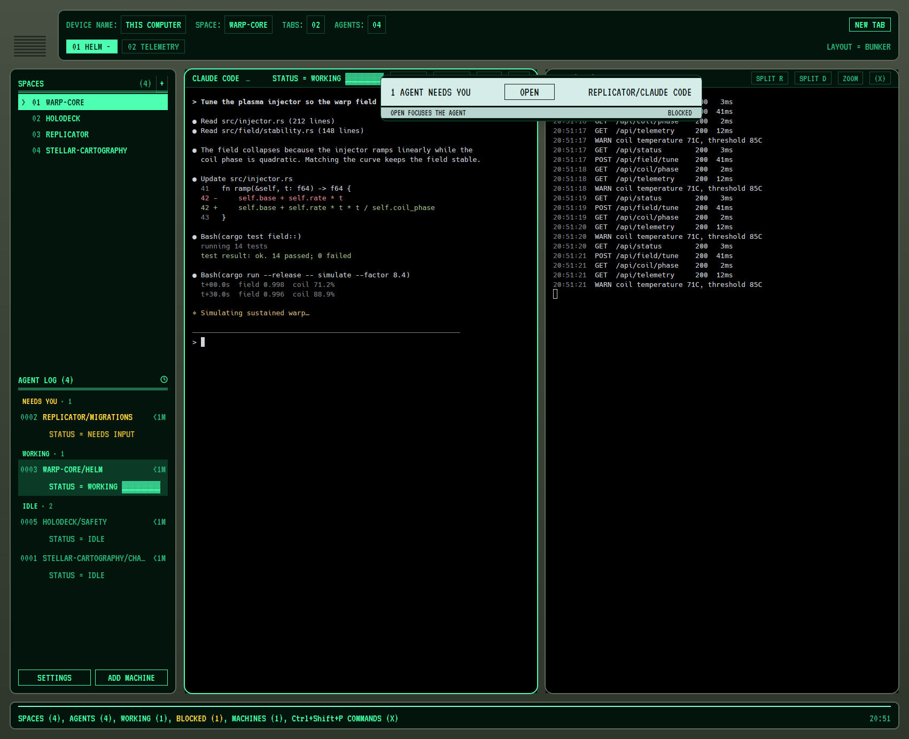

# Bunker

A full-window layout for the Herdr desktop app styled after the utilitarian
terminals of an underground bunker: a grey-green console housing with green
phosphor screens, DOS-style menus, boxed form fields and keys, a numbered
agent log and a keyword index bar. Terminals keep the person's own font, size
and colors.

## What you see

- **Housing:** the window background is a vertical gradient `#475042` to
  `#2f362c`, 18 px padding, 14 px gaps. No system title bar; the macOS window
  buttons sit on a 76 px plate at the top left (`traffic_lights` `[32, 30]`),
  with a seven-slot vent grille (`#252b23`) at its foot.
- **Screens:** every chrome region is a screen: background `#03140d`, 2 px
  border `#5d6859`, radius 12 (index bar 10). Text is VT323 at 18 to 22 px.
  Phosphor `#4dffb0`, dim `#2fb07e`, faint lines `#145038`, bright rule
  `#8affd0`, alert amber `#ffd84d`.
- **Header screen** (96 px tall): row 1 is form fields, `DEVICE NAME:`
  `SPACE:` `TABS:` `AGENTS:`, each value in a faint box, then boxed keys NEW
  TAB, FILES, CHANGES (inverted when open). Row 2 is the tabs as boxed keys,
  `⌘1 CLAUDE CODE`; the shown tab is inverted, a working tab spins
  (`| / - \`), a done one shows ✓, a blocked one turns amber with ! and
  pulses. A faint rule fills the row, then `LAYOUT = BUNKER`.
- **Sidebar screen** (312 px): `SPACES (n)` with a + key over a double rule;
  machines as `[THIS COMPUTER]` in dim with + and `(-)`/`(+)` to fold; spaces
  as `> 01 NAME` with the shown one inverted, git ahead/behind on the right.
  `AGENT LOG (n)` over a double rule; each agent is two lines: its sequence
  number (`0007`) and `SPACE/DETAIL` with its age, then
  `STATUS = WORKING ▓▓▓░░░` (the bar animates), `NEEDS INPUT` in amber, `DONE`
  or `IDLE`. SETTINGS and ADD MACHINE as boxed keys at the foot.
- **Panes:** black terminals in CRT frames, radius 16, 2 px border `#5d6859`,
  focused `#4dffb0`, 12 px apart. A 34 px header on a screen strip:
  program, folder, a faint rule, `STATUS = …`, then SPLIT R, SPLIT D, ZOOM,
  (X) keys (hidden under 560 px).
- **Index bar** (52 px): a 2 px bright rule, then
  `SPACES (3), AGENTS (2), WORKING (1), BLOCKED (0), MACHINES (3), ⌘⇧P COMMANDS (X)`
  and the clock on the right. BLOCKED turns amber and pulses when above zero.
- **Alert bar:** while any agent is blocked, a 600 px pale bar (`#d6ece8`,
  dark text) floats at the top of the work area: `1 AGENT NEEDS YOU`, an
  OPEN box, the agent's space and program; a thinner `#b9d3ce` strip below.

## How it behaves

- Tabs: click selects, drag reorders, double-click renames, right-click opens
  the tab menu, scrolling switches. Space rows drag to reorder.
- OPEN on the alert bar focuses the blocked agent's pane. The alert renders
  nothing when no agent is blocked, so it hides.
- Animations are native (`.frames()` for the spinner and bar, `.loop()` for
  the amber pulse); no redraw timers. The clock checks every 10 s and redraws
  when the minute changes.
- Cmd-B hides the sidebar screen.

## Built from

- `layouts/bunker.json`: root `column` (gradient background, `ui_font`
  VT323, `colors` for chrome, surface, popover, accent, border, selected,
  hover). Rows: `top` (plate, `tabs`), `middle` (`sidebar` column with
  `spaces`, `agents`, `sidebar-footer`; `work-body` with the `main` tab block,
  the hidden `panel` stack and a floating `alert`), `status`. The screens are
  layout nodes with background, border, radius and padding; the mods draw only
  their content.
- `mods/bunker-frame`: new; parts `plate` and `footer`. Carries VT323
  (SIL OFL 1.1) in `fonts/`.
- `mods/bunker-alert`: new.
- `mods/bunker-header` (from `tabs`), `bunker-spaces` (from `spaces`),
  `bunker-agents` (from `agents`), `bunker-pane` (from `pane`),
  `bunker-status` (from `workspace-status`), each by way of the Bridge copies.

## Watch out

- The diagonal CRT raster from the mockup is not built: a background image
  is scaled to fit its node, which blurs a fine raster into a flat tint.
- VT323 is a pixel font; it reads well at 18 px and up, so the layout never
  goes below that.
- `theme.foreground` and `background` are left alone on purpose: overriding
  them would recolor the terminals.
- Herdr's own screens (Settings, palette, dialogs, toasts) keep their shape
  and only take the colors.

## Done when

- `herdr-app check` passes for every `mods/bunker-*` folder.
- After `layout.switch {"name":"bunker"}`, `herdr-app status` shows no errors.
- A working agent spins in its tab key and animates its log bar; a blocked
  one turns amber, pulses, and raises the alert bar with a working OPEN.
